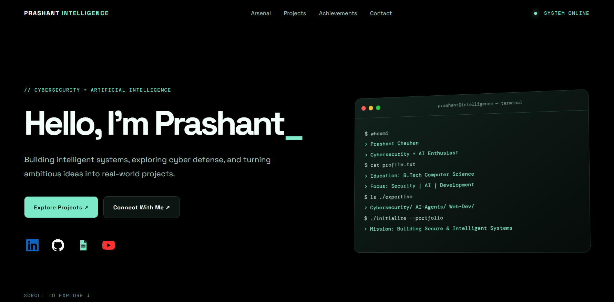
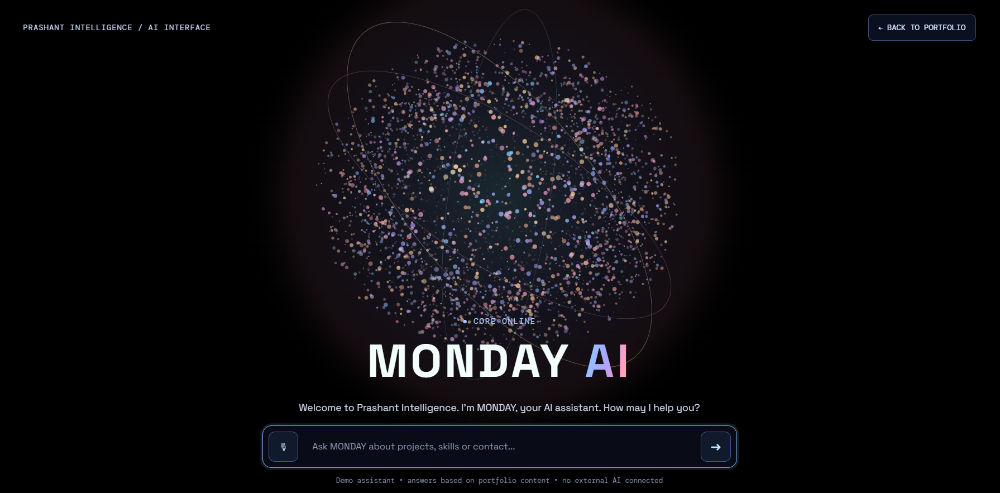

# Prashant Intelligence

I'm **Prashant Chauhan**, a final-year B.Tech Computer Science student focused on cybersecurity and applied AI. My portfolio brings together projects in email security, SOC workflows, document search, and machine learning.

[Portfolio](https://prashantchauhan.vercel.app) · [GitHub](https://github.com/itsprshnt20) · [LinkedIn](https://www.linkedin.com/in/itsprshnt20/)

## Portfolio preview



[**Watch the portfolio walkthrough (26 seconds, MP4 with audio)**](docs/media/portfolio-walkthrough.mp4)

<details>
<summary>See the intro and MONDAY AI screenshots</summary>

### Animated intro


### MONDAY AI



MONDAY is a demo assistant for questions about my projects, skills, and contact information. Its answers are based on portfolio content.

</details>

## Project Vault

| Project | What it does |
| --- | --- |
| **PhishGuard AI** | Analyzes pasted emails and EML files and shows the sender and link evidence behind each risk assessment. |
| **Sentinel-SOC** | Correlates repeated failed sign-ins with a subsequent successful login and displays the matching events. |
| **DocMind AI** | Retrieves relevant passages from PDFs and text files with page or line citations. |
| **ModelForge AI** | Compares binary classifiers, explores decision threshold trade-offs, and exports model cards. |
| **AgentFlow AI** | Drafts support replies from policy references and records human review decisions. |
| **NetSentinel AI** | Flags unusual outbound traffic and explains findings with baseline comparisons and supporting flow records. |
| **VulnHunter AI** | Matches dependency versions to advisories and compares findings before and after updates. |
| **CyberOps AI** | Organizes alerts into cases and exports versioned analyst handoffs. |

## Run locally

From the folder containing `package.json`, install dependencies and start the development server with Node.js and npm.

```bash
npm install
npm run dev
```

Open the local URL printed in the terminal. To build for production, run `npm run build`.

## Contact

I'm interested in internships and entry-level roles in cybersecurity and applied AI. Connect with me on [LinkedIn](https://www.linkedin.com/in/itsprshnt20/).
